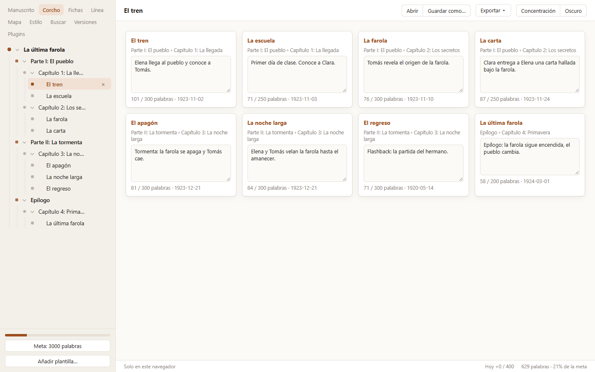
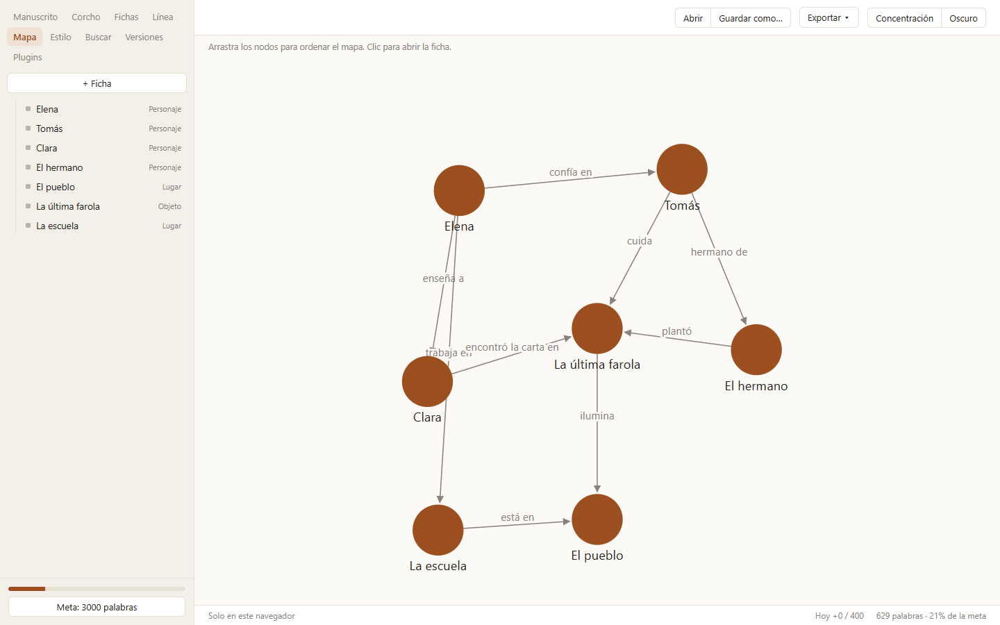
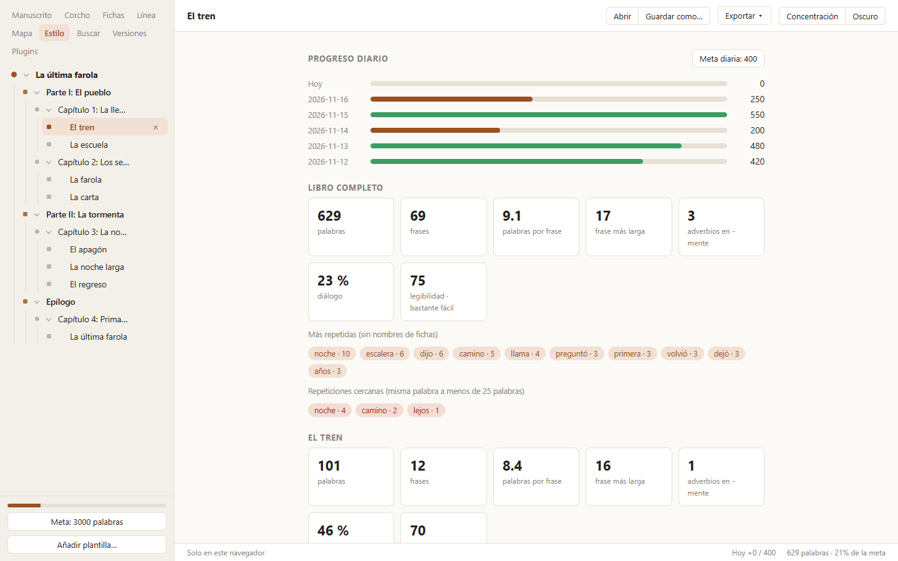
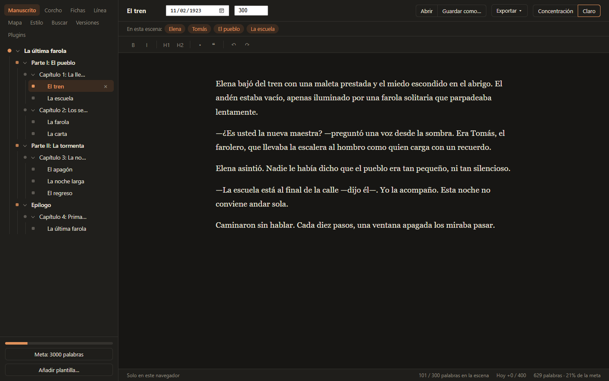

<p align="center">
  
</p>

<h1 align="center">Shakes</h1>

<p align="center">
  <a href="https://github.com/iamjuaness/Shakes/actions/workflows/build.yml"></a>
  <a href="https://github.com/iamjuaness/Shakes/releases/latest"></a>
  <a href="https://github.com/iamjuaness/Shakes/releases"></a>
  <a href="LICENSE"></a>
  
  
  
  
</p>

<p align="center"><b>Herramienta de escritura de historias para escritorio.</b><br>
Organiza el manuscrito como un árbol, mantén un mundo coherente con fichas y mapas, revisa tu estilo y exporta a Word, EPUB o PDF.<br>
Tus datos son tuyos: archivos JSON abiertos, sin cuenta ni nube.</p>

## Capturas

<p align="center">
  
</p>

<table>
  <tr>
    <td><br><sub><b>Corcho</b> · sinopsis y metas por escena</sub></td>
    <td><br><sub><b>Mapa de conexiones</b> · fichas y vínculos</sub></td>
  </tr>
  <tr>
    <td><br><sub><b>Estilo</b> · legibilidad, repeticiones y progreso diario</sub></td>
    <td><br><sub><b>Tema oscuro</b> · y modo concentración</sub></td>
  </tr>
</table>

## Características

**Para cualquier tipo de escrito**
- Novela, cuento, poemario, ensayo / no ficción, artículos / blog, diario, novela epistolar, guion de cine, teatro, cómic / novela gráfica y radio / pódcast. Cada tipo llama a sus piezas por su nombre (capítulo, poema, entrada, carta, página…).
- Libros por partes y capítulos, con cambios de escena (⁂) dentro del capítulo; sagas y universos con fichas compartidas.
- Guion con formato de industria: Tab / Intro entre elementos, autocompletado de personajes, desglose, PDF propio (Courier 12, Carta o A4) y Fountain.

**Escritura cómoda**
- Corrector ortográfico en el idioma de cada libro (unos 90 idiomas); modo «Sin subrayados» para escribir sin el crítico interno.
- Modo concentración, tamaño y ancho del texto, metas por capítulo, libro y día; retomas donde lo dejaste.

**Creatividad**
- Taller creativo: personajes completos de acuerdo a la historia (nombre, edad, oficio, virtudes, defecto, herida, mentira, arco, deseo, miedo, secreto y relación con el protagonista), lugares, objetos, conflictos, giros, «¿y si…?», títulos, «Estoy atascado» y sprints.
- Nombres de 62 culturas y 8 épocas, con las costumbres de cada una, e inventados para fantasía y ciencia ficción.

**Planificación y revisión**
- Corcho, línea de tiempo narrativa y cronológica, estructuras clásicas, fichas del mundo con detección de apariciones y mapa de conexiones entre personajes.
- Estadísticas, repeticiones y muletillas, búsqueda y reemplazo, versiones con comparación y restauración.

**Edición**
- Mesa de edición (informe, correcciones, gramática, punto de vista, voces, plan de pasadas) y lectura en voz alta.
- Control de cambios con lo que devuelven tus lectores y comentarios sobre el texto.

**Salida**
- Maquetación completa de libros (notas al pie, imágenes, tablas, fuentes propias) y cubierta, con vista previa y PDF.
- Word (`.docx`), EPUB, PDF, Markdown, LaTeX, HTML y Fountain; importación desde Word y Markdown.

**Extensible**
- [Plugins](#plugins) de temas, estructuras y herramientas, instalables sin actualizar la app.

## Web y tutoriales

La web de descarga y los tutoriales están en [`docs/`](docs/) (HTML estático, sin compilar) y se publican con **GitHub Pages**: en *Settings → Pages*, elige *Deploy from a branch*, rama `master`, carpeta `/docs`. Quedará en `https://iamjuaness.github.io/Shakes/`. El botón de descarga lee la última release de GitHub, así que no hay que tocar la web en cada versión.

Para verla en local: `python -m http.server 4321 -d docs` y abre <http://localhost:4321>.

## Instalación (Windows)

1. Ve a la [**web de Shakes**](https://iamjuaness.github.io/Shakes/) o a [**Releases**](https://github.com/iamjuaness/Shakes/releases/latest) y descarga `Shakes_<versión>_x64-setup.exe`.
2. Ejecútalo y sigue el asistente.

> El instalador aún no está firmado: Windows SmartScreen puede mostrar «editor desconocido». Pulsa *Más información → Ejecutar de todas formas*.


## Datos y privacidad

- El proyecto se guarda automáticamente en el almacenamiento local de la app (IndexedDB).
- Con **Guardar como…** o **Abrir** se vincula a un archivo `.shks` (JSON) que también se autoguarda. Se abren además `.shakes` y `.json` antiguos.
- Copias automáticas antes de eliminar, reemplazar o restaurar.
- Todo funciona sin conexión; no se envía nada a ningún servidor.

Hay un proyecto de ejemplo en [`ejemplos/La_ultima_farola.shks`](ejemplos/La_ultima_farola.shks).

## Plugins

Un plugin es un archivo JSON. Los de temas y estructuras **no ejecutan código**: solo aportan datos validados. Los de herramientas (`"tool": "id"` y `"main": "main.js"`) traen su código compilado con `npm run plugins` desde [`plugins/herramientas`](plugins/herramientas); Shakes pide confirmación antes de instalarlos y los incluidos en la app se actualizan solos. Todo se instala desde la pestaña **Plugins**, que también lista los de la carpeta [`plugins/`](plugins/README.md).

```json
{
  "shakes": 1,
  "id": "mi-plugin",
  "name": "Mi plugin",
  "version": "1.0.0",
  "description": "Qué aporta.",
  "themes": [
    { "name": "Bosque",
      "light": { "--bg": "#f4f7f2", "--accent": "#2f6b3f" },
      "dark":  { "--bg": "#10150f", "--accent": "#7fc28a" } }
  ],
  "structures": [
    { "name": "Relato corto",
      "parts": [{ "title": "Relato", "chapters": ["Inicio", "Nudo", "Final"] }] }
  ],
  "sceneTemplates": [
    { "name": "Escena de tensión", "genre": "Terror",
      "html": "<h2>Tensión</h2><p><em>Lugar y hora:</em> </p>" }
  ]
}
```

| Campo | Efecto |
|---|---|
| `themes` | Cambia variables CSS: `--bg --surface --panel --text --muted --accent --accent-soft --on-accent --line --shadow --radius`. Valores sin `url(` ni `;`. |
| `structures` | Aparecen en **Añadir plantilla…** junto a las integradas. |
| `sceneTemplates` | Botón **Plantilla de escena…**: inserta el HTML al final de la escena. Solo se conservan etiquetas de texto (`p`, `h1-h6`, `em`, `strong`, `i`, `b`, `ul`, `ol`, `li`, `blockquote`, `br`), sin atributos. |

Ejemplo completo: [`plugins/temas/bosque_y_terror.json`](plugins/temas/bosque_y_terror.json).

## Desarrollo

**Stack:** Tauri 2 · React 19 · TypeScript · Vite · TipTap · fflate.

**Requisitos:** Node 24 (los tests usan `node archivo.ts`), Rust estable y, en Windows, MSVC (workload «Desarrollo para el escritorio con C++») con Windows SDK.

```bash
npm install
npm run dev          # solo web, http://localhost:1420
npm run tauri dev    # app de escritorio
npm run tauri build  # instalador NSIS en src-tauri/target/release/bundle/nsis/
```

**Pruebas:**

```bash
node src/tree.test.ts
node src/export.test.ts
node src/plugins.test.ts
npx tsc --noEmit
```

**Estructura:**

| Ruta | Contenido |
|---|---|
| `src/tree.ts` | Modelo del manuscrito y funciones puras inmutables |
| `src/plugins.ts` | Validación y aplicación de plugins |
| `src/App.tsx` | Orquestación, editor, guardado |
| `src/Views.tsx` | Corcho, línea de tiempo, mapa, estilo, búsqueda, versiones |
| `src/export.ts` | DOCX / EPUB / HTML |
| `src/maqueta/`, `src/Maqueta.tsx` | Composición en páginas, cubierta y PDF |
| `src/revision.ts`, `src/guardado.ts`, `src/progreso.ts` | Control de cambios, guardado seguro y guía |
| `scripts/test.mjs` | Todas las pruebas (`npm test`) |
| `src/store.ts` | IndexedDB |
| `src-tauri/` | Shell nativo (Rust) |

## Publicar una versión

1. Sube la versión en `package.json`, `src-tauri/Cargo.toml` y `src-tauri/tauri.conf.json` (las tres iguales).
2. `git tag v0.4.0 && git push origin v0.3.0`.

El CI compila el instalador y lo adjunta al release.

## Hoja de ruta

- IA con memoria de la historia y detector de inconsistencias.
- Publicación integrada.
- Plugins de terceros con código propio, en un entorno aislado.

## Licencia

Shakes es software libre bajo la **GNU General Public License v3.0**. Puedes usarlo, estudiarlo, modificarlo y redistribuirlo. Si distribuyes una versión modificada, debes publicar su código fuente bajo la misma licencia.

Lo que escribes con Shakes sigue siendo tuyo. La licencia cubre el software, no tus textos.

Texto completo en [LICENSE](LICENSE).

© 2026 [iamjuaness](https://github.com/iamjuaness).
