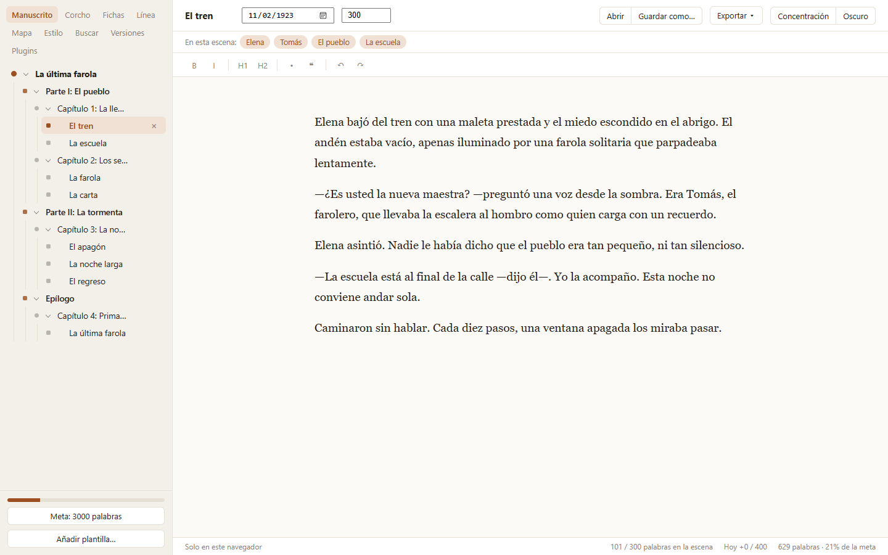

<p align="center">
  
</p>

<h1 align="center">Shakes</h1>

<p align="center">
  <a href="https://github.com/iamjuaness/Shakes/actions/workflows/build.yml"></a>
  <a href="https://github.com/iamjuaness/Shakes/releases/latest"></a>
  <a href="https://github.com/iamjuaness/Shakes/releases"></a>
  <a href="LICENSE"></a>
  
  
  
  
</p>

<p align="center"><b>Herramienta de escritura de historias para escritorio.</b><br>
Organiza el manuscrito como un árbol, mantén un mundo coherente con fichas y mapas, revisa tu estilo y exporta a Word, EPUB o PDF.<br>
Tus datos son tuyos: archivos JSON abiertos, sin cuenta ni nube.</p>

## Capturas

<p align="center">
  
</p>

<table>
  <tr>
    <td><br><sub><b>Corcho</b> · sinopsis y metas por escena</sub></td>
    <td><br><sub><b>Mapa de relaciones</b> · fichas y vínculos</sub></td>
  </tr>
  <tr>
    <td><br><sub><b>Estilo</b> · legibilidad, repeticiones y progreso diario</sub></td>
    <td><br><sub><b>Tema oscuro</b> · y modo concentración</sub></td>
  </tr>
</table>

## Características

**Escritura**
- Manuscrito en árbol: libro → partes → capítulos → escenas, con arrastrar y soltar, reordenar con `Alt+↑↓` y navegación por teclado accesible (ARIA).
- Editor de texto enriquecido (TipTap): negrita, cursiva, títulos, listas, citas, deshacer/rehacer.
- Modo concentración, tema claro/oscuro, metas de palabras por libro, por escena y diaria, con progreso por día.
- Plantillas de estructura: Tres actos, Viaje del héroe, Save the Cat, Siete puntos, Fábula y Cuento.

**Planificación**
- Corcho con sinopsis por escena.
- Línea de tiempo narrativa y cronológica (fecha por escena).
- Fichas del mundo (Personaje, Lugar, Objeto, Facción) con detección de en qué escenas aparece cada una.
- Mapa de relaciones entre fichas, con nodos arrastrables.

**Revisión**
- Análisis de estilo: longitud de frases, adverbios en *-mente*, palabras repetidas (y repeticiones cercanas), porcentaje de diálogo y legibilidad INFLESZ.
- Búsqueda y reemplazo en todo el libro.
- Versiones: instantáneas manuales y automáticas (cada 10 min), comparación y restauración con copia previa.

**Salida**
- Exporta a Markdown, Word (`.docx`), EPUB y PDF (vía impresión).

**Extensible**
- Sistema de [plugins](#plugins): temas, estructuras y plantillas de escena.

## Instalación (Windows)

1. Ve a [**Releases**](https://github.com/iamjuaness/Shakes/releases/latest) y descarga `Shakes_<versión>_x64-setup.exe`.
2. Ejecútalo y sigue el asistente.

> El instalador aún no está firmado: Windows SmartScreen puede mostrar «editor desconocido». Pulsa *Más información → Ejecutar de todas formas*.


## Datos y privacidad

- El proyecto se guarda automáticamente en el almacenamiento local de la app (IndexedDB).
- Con **Guardar como…** o **Abrir** se vincula a un archivo `.shks` (JSON) que también se autoguarda. Se abren además `.shakes` y `.json` antiguos.
- Copias automáticas antes de eliminar, reemplazar o restaurar.
- Todo funciona sin conexión; no se envía nada a ningún servidor.

Hay un proyecto de ejemplo en [`ejemplos/La_ultima_farola.shks`](ejemplos/La_ultima_farola.shks).

## Plugins

Un plugin es un archivo JSON. Los de temas y estructuras **no ejecutan código**: solo aportan datos validados. Los de herramientas (`"tool": "id"`) activan código que ya viene incluido en la app (carpeta [`plugins/herramientas`](plugins/herramientas)); un JSON nunca trae código propio. Todo se instala desde la pestaña **Plugins**, que también lista los de la carpeta [`plugins/`](plugins/README.md).

```json
{
  "shakes": 1,
  "id": "mi-plugin",
  "name": "Mi plugin",
  "version": "1.0.0",
  "description": "Qué aporta.",
  "themes": [
    { "name": "Bosque",
      "light": { "--bg": "#f4f7f2", "--accent": "#2f6b3f" },
      "dark":  { "--bg": "#10150f", "--accent": "#7fc28a" } }
  ],
  "structures": [
    { "name": "Relato corto",
      "parts": [{ "title": "Relato", "chapters": ["Inicio", "Nudo", "Final"] }] }
  ],
  "sceneTemplates": [
    { "name": "Escena de tensión", "genre": "Terror",
      "html": "<h2>Tensión</h2><p><em>Lugar y hora:</em> </p>" }
  ]
}
```

| Campo | Efecto |
|---|---|
| `themes` | Cambia variables CSS: `--bg --surface --panel --text --muted --accent --accent-soft --on-accent --line --shadow --radius`. Valores sin `url(` ni `;`. |
| `structures` | Aparecen en **Añadir plantilla…** junto a las integradas. |
| `sceneTemplates` | Botón **Plantilla de escena…**: inserta el HTML al final de la escena. Solo se conservan etiquetas de texto (`p`, `h1-h6`, `em`, `strong`, `i`, `b`, `ul`, `ol`, `li`, `blockquote`, `br`), sin atributos. |

Ejemplo completo: [`plugins/temas/bosque_y_terror.json`](plugins/temas/bosque_y_terror.json).

## Desarrollo

**Stack:** Tauri 2 · React 19 · TypeScript · Vite · TipTap · fflate.

**Requisitos:** Node 24 (los tests usan `node archivo.ts`), Rust estable y, en Windows, MSVC (workload «Desarrollo para el escritorio con C++») con Windows SDK.

```bash
npm install
npm run dev          # solo web, http://localhost:1420
npm run tauri dev    # app de escritorio
npm run tauri build  # instalador NSIS en src-tauri/target/release/bundle/nsis/
```

**Pruebas:**

```bash
node src/tree.test.ts
node src/export.test.ts
node src/plugins.test.ts
npx tsc --noEmit
```

**Estructura:**

| Ruta | Contenido |
|---|---|
| `src/tree.ts` | Modelo del manuscrito y funciones puras inmutables |
| `src/plugins.ts` | Validación y aplicación de plugins |
| `src/App.tsx` | Orquestación, editor, guardado |
| `src/Views.tsx` | Corcho, línea de tiempo, mapa, estilo, búsqueda, versiones |
| `src/export.ts` | DOCX / EPUB / PDF |
| `src/store.ts` | IndexedDB |
| `src-tauri/` | Shell nativo (Rust) |

## Publicar una versión

1. Sube la versión en `package.json`, `src-tauri/Cargo.toml` y `src-tauri/tauri.conf.json` (las tres iguales).
2. `git tag v0.2.0 && git push origin v0.2.0`.

El CI compila el instalador y lo adjunta al release.

## Hoja de ruta

- IA con memoria de la historia y detector de inconsistencias.
- Publicación integrada.
- Plugins de terceros con código propio, en un entorno aislado.

## Licencia

Shakes es **gratuito y de código visible**. Puedes usarlo para lo que quieras, estudiarlo, modificarlo y redistribuirlo, con estas reglas:

- **Siempre gratuito:** no se puede vender, alquilar, cobrar por suscripción ni monetizar su distribución, ni original ni modificado.
- **Las modificaciones** usan esta misma licencia, con su código fuente, y deben dejar claro que no son la versión oficial (otro nombre e icono).
- **Lo que escribes es tuyo:** todo lo que cualquier persona cree con Shakes pertenece únicamente a esa persona. Nadie más adquiere derechos sobre ello.

Texto completo en [LICENSE](LICENSE).

© 2026 [iamjuaness](https://github.com/iamjuaness).
